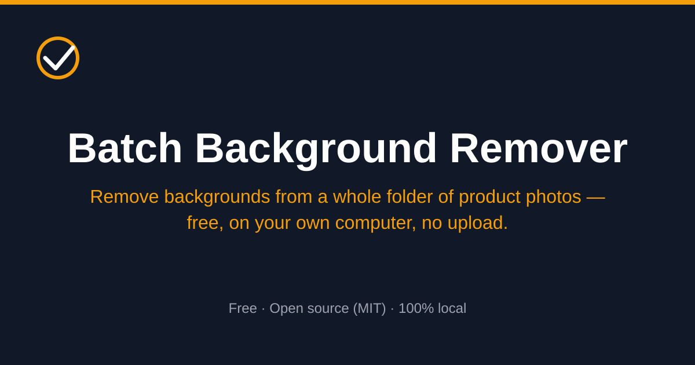
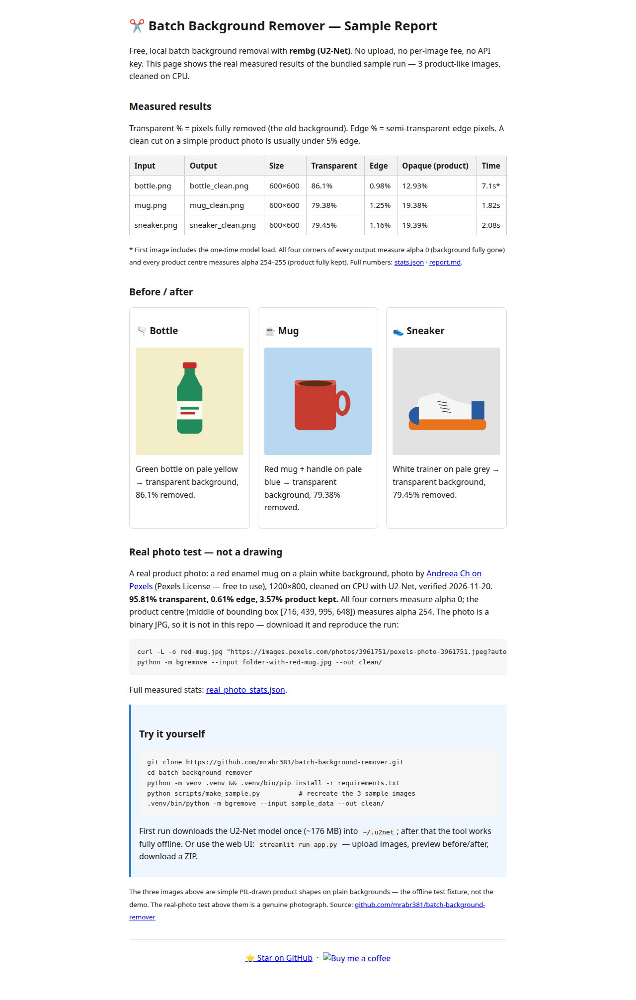
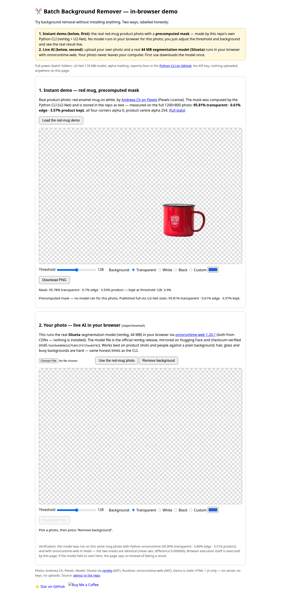
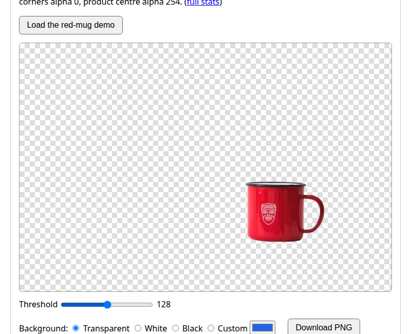

# ✂️ Batch Background Remover



[](https://github.com/mrabr381/batch-background-remover/actions/workflows/ci.yml)
[](https://www.python.org/)
[](LICENSE)
[](#quickstart)
[](#web-app--how-it-works)
[](https://github.com/mrabr381/batch-background-remover)
[](https://www.buymeacoffee.com/muhammadabubakar)

**Remove backgrounds from a whole folder of product photos — free,
local, no upload, no per-image fee, no API key.** Built on
[rembg](https://github.com/danielgatis/rembg) (U2-Net, MIT-licensed
model) running on your own CPU, with a simple web UI to review
before/after and download everything as a ZIP.

> **Try it now — live in-browser demo:** [mrabr381.github.io/batch-background-remover/demo/](https://mrabr381.github.io/batch-background-remover/demo/) — instant demo on the real red-mug photo with a precomputed mask, plus a live AI option that runs a 44 MB model in your browser (no upload, no key). Full power via the web app (1-click deploy): share.streamlit.io → Create app → repo `mrabr381/batch-background-remover`, branch `main`, file `app.py` → Deploy. No key needed; first run downloads the ~176 MB model. Real numbers below: [sample report page](sample_output/index.html).


*The sample report — measured results for the three sample images, before/after cards, and the real-photo test (95.81% transparent, 0.61% edge).*


*Screenshot — the red-mug pane: cut-out mug on transparency, threshold 128, mask stats (95.78% transparent · 0.7% edge · 3.53% product). The live-AI pane below it is empty until you upload a photo.*


*GIF — moving the threshold slider on the red-mug pane.*

## Real photo test — the hero result

A real product photo, not a drawing: a red enamel mug on a plain white
background. Photo by [Andreea Ch on Pexels](https://www.pexels.com/photo/red-mug-3961751/)
(Pexels License — free to use), 1200×800, cleaned on CPU with U2-Net,
verified 2026-11-20. All four corners measure alpha 0 (background fully
gone); the product centre — middle of the detected bounding box
`[716, 439, 995, 648]` — measures alpha 254 (product fully kept). The mug
sits right of centre, so the image-centre pixel is background (alpha 0).

**Measured: 95.81% transparent, 0.61% edge, 3.57% product kept** (1200×800).

```bash
curl -L -o red-mug.jpg "https://images.pexels.com/photos/3961751/pexels-photo-3961751.jpeg?auto=compress&cs=tinysrgb&w=1200"
python -m bgremove --input folder-with-red-mug.jpg --out clean/
```

Full measured stats: [sample_output/real_photo_stats.json](sample_output/real_photo_stats.json).

## Offline test fixture (PIL drawings)

The 3 bundled sample images are simple PIL-drawn product shapes — the
**offline test fixture**, not the demo. Run on CPU, U2-Net model:

| Image | Transparent | Edge | Product kept |
|-------|-------------|------|--------------|
| Bottle (green on pale yellow) | **86.1%** | 0.98% | 12.93% opaque |
| Mug (red + handle on pale blue) | **79.38%** | 1.25% | 19.38% opaque |
| Sneaker (white trainer on pale grey) | **79.45%** | 1.16% | 19.39% opaque |

Measured, not eyeballed: all 4 corners of every output are alpha 0,
every product centre is alpha 254–255, the edge band is ~1%, and two
runs on the same input produce byte-identical PNGs (md5sum-verified).
Full numbers: [sample_output/report.md](sample_output/report.md) ·
[sample_output/stats.json](sample_output/stats.json).

## Quickstart

```bash
git clone https://github.com/mrabr381/batch-background-remover.git
cd batch-background-remover
python -m venv .venv && .venv/bin/pip install -r requirements.txt
python scripts/make_sample.py   # recreate the 3 sample images (generated locally, not committed)
.venv/bin/python -m bgremove --input sample_data --out clean/
```

First run downloads the U2-Net model once (~176 MB) into `~/.u2net`;
after that fully offline. ~2 s per 600×600 image on a 4-core CPU after
the first one (which includes model load).

## CLI reference

```
python -m bgremove --input photos/ --out clean/ [options]
```

| Option | Default | What it does |
|--------|---------|--------------|
| `--input` | — (required) | Folder of input images (png, jpg, jpeg, webp, bmp) |
| `--out` | — (required) | Folder for cleaned images |
| `--format` | `png` | `png` keeps transparency; `jpg` needs a background (defaults to white) |
| `--bg` | `transparent` | `transparent`, `white`, `black`, or `#RRGGBB` |
| `--alpha-matting` | off | Refine edges (slower, better on hair / fine edges) |
| `--model` | `u2net` | `u2net`, `u2net_human_seg` (people), `u2netp` (small/fast), `isnet-general-use` |

Also `--report` / `--stats-json` write a Markdown report / stats JSON.
Exit codes: `0` success · `1` input folder missing, no images, or an unreadable
file · `2` bad arguments. Example: white-background JPGs for marketplaces —
`--format jpg --bg white`; people photos — `--model u2net_human_seg
--alpha-matting --report report.md`.

## Web app + how it works

`.venv/bin/streamlit run app.py` — upload images, pick a model and
background, preview before/after with the measured transparency numbers,
download all cleaned images as a ZIP. Nothing is uploaded anywhere.
Under the hood: **rembg + U2-Net** segments the foreground on your CPU
(ONNX Runtime; model downloaded once and cached) → optional **alpha
matting** refines fine edges → **background** applied (transparent PNG,
or composite onto a solid colour) → **measurement** scores every output
(transparent / edge / opaque %, bounding box, corner + centre alpha), so
a bad cut is a number, not a feeling.

## Honest limitations

- **Hair, fur, glass and fine edges are hard.** U2-Net does well on solid
  product shots; wispy hair or transparent glass can leave a halo or a hole.
  `--alpha-matting` helps, but it is not magic — check the edge % in the report.
- **Busy or same-colour backgrounds confuse it** (a white mug on a white
  background is genuinely hard). Plain, contrasting backgrounds work best.
- **CPU speed + model download.** ~2 s per 600×600 image on a 4-core CPU;
  large photos take longer; no GPU support. First run needs internet for
  the one-time ~176 MB U2-Net download; after that, fully offline.
- **Real photos score worse than the drawings** (shadows, reflections,
  clutter) — see the real-photo numbers above: 95.81% transparent, 0.61% edge.

Layout: `app.py` (Streamlit web app) · `bgremove/` (`cli.py`, `core.py`,
`report.py`) · `scripts/make_sample.py` (regenerates the 3 PIL sample
images) · `sample_data/` (generated locally, never committed) ·
`sample_output/` (measured report + stats + demo page) · `tests/` (pytest).

MIT — see [LICENSE](LICENSE). Issues and pull requests are welcome: no
invented numbers, no hardcoded results, and every new metric covered by a
measurement on the sample images.
